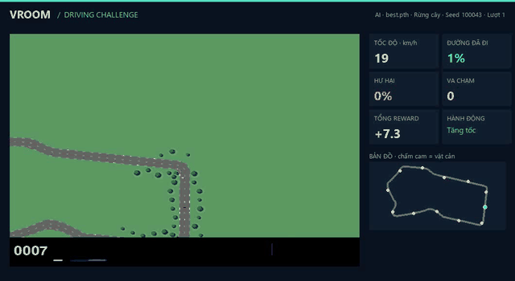

# Double DQN for Car Racing

A reinforcement learning project implementing and comparing **Tabular Q-Learning**, **Deep Q-Network (DQN)**, and **Double Deep Q-Network (Double DQN)** on the Gymnasium Car Racing environment.

The primary objective is to investigate how progressively more advanced value-based reinforcement learning methods perform on a visual control task. The repository includes a complete training pipeline, a custom environment wrapper, experiment logging, checkpoint management, and a standalone demo application. Only the Double DQN agent is included in this repository; the Q-Learning and DQN baselines are described in the report but their code and logs are not part of it.

---

## Demo



Full video (74 s, H.264): [docs/media/demo-vroom.mp4](docs/media/demo-vroom.mp4)

The video shows the greedy agent (speed-penalty model, see [Obstacle Driving Challenges](#obstacle-driving-challenges))
on four forest tracks it never saw during training: seeds 100043, 100053, 100070 and 100052. These are the four
cleanest runs out of 30 evaluated tracks (no collisions, 90–98% of the track before the time limit). They are
**selected**, not typical: across all 30 tracks the agent covers 64% of the track on average and collides
1.1 times per episode.

---

## Features

- Double Deep Q-Network (Double DQN)
- Vanilla Deep Q-Network (DQN) baseline
- Tabular Q-Learning baseline
- CNN-based Q-network using PyTorch
- Experience replay and target network
- Custom Car Racing environment wrapper
- Frame preprocessing, stacking, and skipping
- Automatic checkpointing and logging
- Training, evaluation, and resume modes
- Standalone demo application

---

## Repository Structure

```text
.
├── dqn/
│   ├── agents/
│   ├── configs/
│   ├── environment/      # CarRacing wrapper + obstacle challenge (challenge_racing.py)
│   ├── logs/
│   ├── models/
│   ├── utils/
│   ├── train.py
│   ├── benchmark.py
│   └── demo_ui.py
├── colab/                # Colab notebooks and GPU benchmarks
├── kaggle/               # Kaggle GPU training notebook
├── tests/                # environment and replay-memory checks
├── docs/media/           # demo video and GIF
├── report-paper.pdf
└── README.md
```

---

## Algorithms

| Algorithm | Purpose |
|-----------|---------|
| Q-Learning | Classical tabular RL baseline |
| DQN | Deep RL baseline |
| Double DQN | Main implementation |

---

## Project Architecture

```text
Gymnasium CarRacing-v3
        │
        ▼
Custom Environment Wrapper
        │
        ├── Observation preprocessing
        ├── Frame stacking
        ├── Frame skipping
        └── Reward processing
        │
        ▼
Double DQN Agent
        │
        ▼
CNN Q-Network
        │
        ▼
Discrete Action Selection
```

---

## Installation

```bash
git clone https://github.com/phuvo05/vroom.git
cd vroom/
pip install -r dqn/requirements.txt
```

---

## Usage

### Train

```bash
python dqn/train.py
```

### Resume Training

```bash
python dqn/train.py --resume <checkpoint>
```

### Evaluate

```bash
python dqn/train.py --eval <checkpoint>
```

### Launch Demo

```bash
python dqn/demo_ui.py
```

---

## Obstacle Driving Challenges

The demo now offers forest, city and desert scenery, two obstacle densities,
rain with reduced tire grip, a minimap, collision/damage telemetry, and keyboard
driving. Barriers, parked cars and crates have solid Box2D fixtures and appear
in both the agent's observations and the demo camera. Each newly hit obstacle
costs 80 reward; total damage of 100 ends the episode. The original classic/dry
mode remains available for comparing old checkpoints.

Old track-following weights have not learned the new hazards. Train a new model:

```bash
python dqn/train.py --scenario forest --difficulty normal --weather dry --max-minutes 60
```

Training outputs go into a separate timestamped `runs/` directory. Select the
resulting checkpoint in the demo with **Chọn model .pth**. Start with the same
scene, difficulty and weather used for training.

Self-contained Colab notebooks and bounded T4/A100 benchmarks are described in
[colab/README.md](colab/README.md).

Run the environment checks with `python -m unittest discover -s tests -v`.

### Speed penalty and Kaggle training

A first obstacle model (about 3,000 forest episodes) drove at roughly 180–220 km/h even in sharp bends and
often missed them. Two changes address this:

- **Speed penalty** (forest/city/desert only; `classic` keeps the original reward). Every simulator frame,
  `0.01 · max(0, v − v_safe)` is subtracted, with `v_safe = clip(220 − 110·κ, 60, 220)` km/h and `κ` the heading
  change (rad) over the next 10 track tiles. See `speed_penalty` in
  [dqn/environment/challenge_racing.py](dqn/environment/challenge_racing.py).
- **Replay memory** of 100,000 transitions (was 10,000), stored as uint8 frames (lossless, about 5.6 GB at capacity).

The model was then warm-started from the first model's weights and trained for 1,500 episodes with
[kaggle/VROOM_Kaggle_GPU.ipynb](kaggle/VROOM_Kaggle_GPU.ipynb) (see [kaggle/README.md](kaggle/README.md)).
The 100-episode training average peaked at 279.6 at episode 1,384, which is the kept checkpoint. Logs of this
run (per-episode metrics, curves, config, final evaluation) are in
[dqn/logs/obstacle_forest_speed_penalty/](dqn/logs/obstacle_forest_speed_penalty/).

Greedy evaluation in the forest scene, normal difficulty:

| Model, tracks | Track progress | Collisions / episode | Full laps | Collision-free |
|---|---|---|---|---|
| First model, seeds 1000–1009 | 43.8% | 1.4 | 1/10 | 0/10 |
| Speed penalty, seeds 100042–100051 (Kaggle GPU) | 61.6% | 1.1 | 0/10 | 1/10 |
| Speed penalty, seeds 100042–100071 (CPU) | 64.5% | 1.1 | 0/30 | 5/30 |

The first model's tracks lie inside its training-seed range and the two models use different rewards, so this
is an indicative rather than a controlled comparison. The agent still has no reverse gear and usually hits the
first obstacle; obstacle avoidance remains the main open problem. Details are in Section VIII of the report.

Reproduce an evaluation (put the checkpoint in `checkpoints/best.pth`, which is git-ignored):

```bash
python dqn/train.py --eval checkpoints/best.pth --scenario forest --eval-episodes 30 --headless --seed 100042
```

## Training Outputs

During training, the project generates:

- Model checkpoints
- Best-performing model
- Training logs
- Learning curves and visualizations

---

## Results

The training log and curves of the Double DQN run are in `dqn/logs/`. The full comparison with Q-Learning and DQN, and the obstacle-driving extension (Section VIII), are reported in `report-paper.pdf`.

---

## Authors

- Vo Thien Phu
- Nguyen Truong Phuc Thinh

